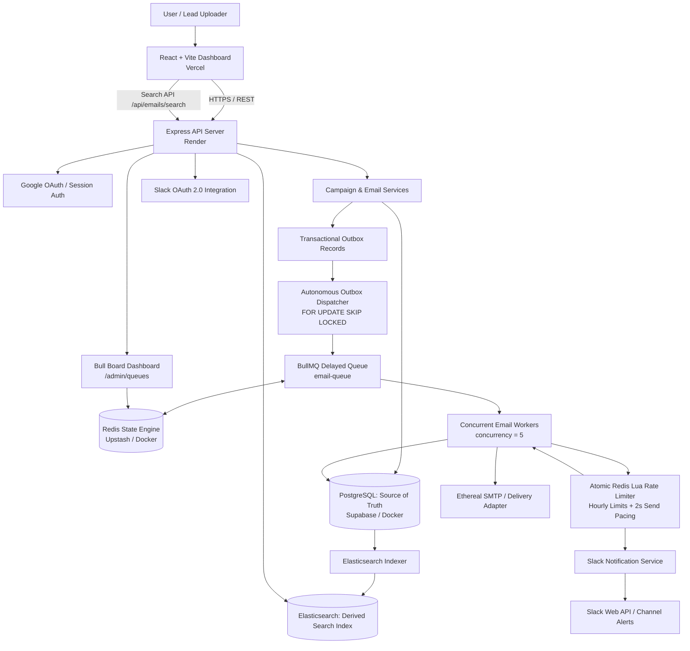

# ReachInbox Full-Stack Email Scheduler

A production-grade distributed email job scheduler service and interactive dashboard built with **TypeScript**, **Express**, **PostgreSQL**, **Redis**, **BullMQ**, **Ethereal SMTP**, **Elasticsearch**, **Slack OAuth 2.0**, **Google OAuth 2.0**, and **React**.

---

### 🌐 Live Production Deployments ($0 Free-Tier Architecture)

| Component | Provider | Live URL |
| :--- | :--- | :--- |
| **Frontend Dashboard** | Vercel | [https://reachinbox-orcin-mu.vercel.app](https://reachinbox-orcin-mu.vercel.app) |
| **Backend REST API** | Render Web Service | [https://reachinbox-api-786c.onrender.com](https://reachinbox-api-786c.onrender.com) |
| **Live Bull Board Queue Monitor** | Render + BullMQ | [https://reachinbox-api-786c.onrender.com/admin/queues](https://reachinbox-api-786c.onrender.com/admin/queues) |
| **PostgreSQL Database** | Supabase | Port `6543` (PgBouncer Connection Pooler) |
| **Distributed Queue & Rate Limiter** | Upstash Redis | Secure TLS (`rediss://...`) |

---

## 1. High-Level System Architecture



### Core Architectural Principle
> **PostgreSQL is the source of truth, Redis/BullMQ is the execution engine, and Elasticsearch is a derived search index.**

---

## 2. Technical Mechanics & Hard Constraints

### 2.1 ❌ Strictly NO Cron Jobs
The scheduling architecture adheres to the hard constraint: **zero OS-level cron** (`crontab`) and **zero Node cron libraries** (`node-cron`, `cron`, `agenda`).
- All scheduled deliveries use **BullMQ delayed jobs** backed by Redis sorted sets (`ZSET`).
- Jobs sleep efficiently in Redis and wake up workers precisely when the delay expires without continuous database table polling.

### 2.2 Mathematical Scheduling Interval
When scheduling a campaign with start time $T_{start}$, interval delay $D$ (seconds), and $N$ recipients, the planned execution time for recipient $i$ ($i \in [1, N]$) is computed deterministically:

$$T_i = T_{start} + ((i - 1) \times D)$$

Every email's `scheduledAt` timestamp is calculated and persisted in PostgreSQL before any job is pushed to the queue.

### 2.3 Transactional Outbox Pattern (Dual-Write Prevention)
To solve the dual-write problem (where committing to the database succeeds but pushing to the queue fails during network blips or crashes):
1. **Single Atomic Transaction**: When a campaign is created, PostgreSQL executes `prisma.$transaction`:
   - 1 `Campaign` record
   - $N$ `Email` records (status: `SCHEDULED`)
   - $N$ `Outbox` records (status: `pending`)
2. **Autonomous Background Dispatcher**: Polls pending records using row-level locking:
   ```sql
   SELECT id, payload, attempts, "availableAt"
   FROM outbox_records
   WHERE status = 'pending' AND "availableAt" <= NOW()
   ORDER BY "availableAt" ASC
   LIMIT 50
   FOR UPDATE SKIP LOCKED;
   ```
3. `SKIP LOCKED` guarantees multiple dispatcher instances run concurrently without race conditions, deadlocks, or duplicate dispatches.
4. Records are published to BullMQ with deterministic IDs (`email-${emailId}`).
5. Only upon confirmed queue insertion is the outbox record marked `published`.

### 2.4 Distributed Atomic Hourly Rate Limiting (Redis Lua)
To enforce per-sender limits safely across multiple worker instances and server nodes, ReachInbox executes an atomic **Redis Lua script**:
- **Hourly Window Key**: `rate-limit:sender:{senderId}:{hourWindow}`
- **Pacing Lock Key**: `pacing:sender:{senderId}`
- **Zero Job Loss**: If hourly capacity is exhausted:
  - Jobs are **never dropped or failed**.
  - The job is marked `deferred` in PostgreSQL.
  - BullMQ automatically reschedules the job targeting the opening of the next hour window while preserving order.
  - The worker concurrency slot is released immediately (no blocking `setTimeout`).
- **Send Pacing Interval**: A minimum 2-second delay between individual sends (`minDelayMs = 2000`) is enforced atomically.

### 2.5 Slack Notification on Rate Limit Hit
When a sender reaches their hourly capacity limit:
1. `SlackNotificationService` formats a Block Kit alert detailing the sender, hourly limit, number of deferred emails, and next available dispatch window.
2. An atomic Redis deduplication key `slack:alert-sent:{senderId}:{windowKey}` with a 1-hour TTL prevents spamming the channel repeatedly in the same window.
3. If Slack is not connected, the rate-limiting engine handles it gracefully (non-blocking fallback with zero crashes).

### 2.6 Persistence & Crash Recovery Across Restarts
- Redis is configured with `appendonly yes` and `maxmemory-policy noeviction` so delayed queue state survives server restarts.
- If a server process crashes:
  - Unsent emails remain safely in PostgreSQL and Redis.
  - The outbox dispatcher and BullMQ workers resume pending/delayed jobs immediately on boot.
  - Workers use atomic conditional transitions (`scheduled` $\rightarrow$ `processing`), ensuring confirmed sends are **never re-sent or restarted from scratch**.

---

## 3. Frontend Features & Figma Alignment

Built with React 18, Vite, TypeScript, and Tailwind CSS, strictly matching the Figma specifications:

1. **Google OAuth 2.0 & Session Management**:
   - Real Google OAuth authentication redirecting to dashboard.
   - Header displaying user name, email, avatar, and logout option.
   - Demo access fallback for offline evaluation.
2. **Compose Email & Interactive Split Button**:
   - **"Send Later" / "Send Now" Split Button**: Primary action button toggles between immediate send and scheduled send, with dedicated chevron dropdown menu.
   - **Quick Presets**: Tomorrow morning (9:00 AM), Tomorrow 10:00 AM, Tomorrow afternoon (3:00 PM), and `datetime-local` picker.
   - **CSV Lead List Upload**: Parses `.csv` lead files via `PapaParse`, deduplicates addresses, and shows live recipient chips.
   - **Rate Limiting Controls**: Configurable pacing delay (sec) and hourly limit per campaign.
3. **Multi-Location Attachment System**:
   - Dedicated **"Attach"** button in top header bar with live numeric file counter badge.
   - Dedicated **"Attach"** button inside the rich formatting toolbar pill.
   - Attachment preview tray with filename, formatted size (`KB`/`MB`), remove (`X`) buttons, and `+ Add more`.
   - Binary data encoded as base64 data URLs for seamless cloud persistence.
4. **Gmail-Style In-App Lightbox Attachment Previewer**:
   - Clicking any attachment opens an in-app full-screen dark lightbox overlay (`bg-black/85`):
     - **Images**: Crisp, responsive centered image preview with inline card thumbnails.
     - **PDFs**: Interactive embedded multi-page PDF viewer directly in the modal (bypasses browser popup blocks).
     - **Text / Code**: Formatted monospace viewer for `.txt`, `.csv`, `.json`.
     - **Direct Downloads**: Dedicated Download button and "Open in tab" action.
5. **Interactive Starred Emails (Favorites)**:
   - Clickable star on any email row in Scheduled, Sent, or Email Detail View.
   - Toggles vibrant gold fill (`fill-amber-400 text-amber-400`).
   - Persisted in `localStorage` across page navigations and reloads.
6. **Interactive Filter & Sort Popover**:
   - Filter menu anchored next to the search bar:
     - **⭐ Show starred only**: Filters active table to show only favorited emails.
     - **Status filter**: Scheduled vs. Deferred (in Scheduled) / Sent vs. Failed (in Sent).
     - **Sender filter**: Filter by specific sender email address.
     - **Sort order**: Toggle between Newest first and Oldest first.
     - **Active filter indicator**: Green dot badge when filters are applied, with one-click "Reset all".
7. **Verified Delivery Audit Report Download**:
   - In the email detail view's ReachInbox Delivery Verification card, click **"Download Delivery Report"** to generate a verified `.txt`/audit log containing email ID, timestamps, recipient, provider message ID, and outbox delivery proof.
8. **Real-time Queue Polling & Elasticsearch Search**:
   - Instant search bar querying `/api/emails/search` powered by Elasticsearch.
   - Real-time 8s dashboard polling for live queue updates without page refreshes.

---

## 4. Technology Stack

| Layer | Technology | Role |
| :--- | :--- | :--- |
| **Frontend** | React 18 + Vite + TypeScript | Interactive UI, split button, lightbox previewer, lead upload |
| **Styling** | Tailwind CSS + Lucide Icons | Responsive styling, status chips, custom modal designs |
| **Backend** | Node.js + Express + TypeScript | REST APIs, validation, rate limiting, and outbox dispatcher |
| **Database** | PostgreSQL 16 (Supabase / Docker) | Authoritative source of truth with ACID transactions |
| **ORM** | Prisma | Type-safe schema migrations and relational queries |
| **Queue** | BullMQ | Delayed scheduling, worker pools, retries (no cron) |
| **Cache/State** | Redis 7 (Upstash / Docker) | Distributed rate limiting, pacing, BullMQ backend |
| **SMTP Testing** | Nodemailer + Ethereal SMTP | Mock email delivery, test preview URLs, simulated adapter |
| **Search Engine** | Elasticsearch 8 (Docker / fallback) | Full-text email search by recipient, subject, and content |
| **Observability** | Bull Board (`/admin/queues`) | Real-time queue metrics and job visualizer |
| **Auth** | Google OAuth 2.0 & Session JWT | User authentication and secure credential handling |
| **Notifications**| Slack OAuth 2.0 + Web API | Live rate-limit alerts with Redis 1-hour deduplication |

---

## 5. Local Development Setup

### 5.1 Prerequisites
- **Node.js**: v18+ (tested on v20 and v24)
- **Docker Desktop**: for running local PostgreSQL, Redis, and Elasticsearch containers

### 5.2 Start Local Infrastructure
```bash
docker compose up -d
```
Starts:
- PostgreSQL on `localhost:5433`
- Redis on `localhost:6379`
- Elasticsearch on `localhost:9200`

### 5.3 Install Dependencies & Seed Database
```bash
# Install root and workspace dependencies
npm install

# Build shared package
npm run build --workspace=@reachinbox/shared

# Push Prisma schema to PostgreSQL
npx prisma db push --schema=apps/backend/prisma/schema.prisma

# Seed demo user and default sender
npx ts-node apps/backend/src/prisma/seed.ts
```

### 5.4 Run Development Servers
```bash
# Terminal 1: Backend API, Outbox Dispatcher, and Email Worker
npm run dev:backend

# Terminal 2: React + Vite Frontend Dashboard
npm run dev:frontend
```
- **Frontend Dashboard**: [http://localhost:5173](http://localhost:5173)
- **Backend API**: [http://localhost:5000](http://localhost:5000)
- **Bull Board Queue Monitor**: [http://localhost:5000/admin/queues](http://localhost:5000/admin/queues)

---

## 6. Automated Verification Test Suites

Every major feature includes an automated verification test suite:

| Test Suite | Purpose | Command |
| :--- | :--- | :--- |
| **Sprint 1** | Verifies PostgreSQL, Redis, Elasticsearch, and health endpoints | `npx ts-node apps/backend/src/test-sprint1.ts` |
| **Sprint 2** | Verifies Campaign REST APIs, interval formula, idempotency, and cancellation | `npx ts-node apps/backend/src/test-sprint2.ts` |
| **Sprint 3** | Verifies BullMQ queue, outbox dispatcher, Ethereal SMTP delivery, and restart recovery | `npx ts-node apps/backend/src/test-sprint3.ts` |
| **Sprint 4** | Verifies atomic Lua rate limiting, deferred rescheduling, Slack alert deduplication, and Bull Board | `npx ts-node apps/backend/src/test-sprint4.ts` |
| **Sprint 5** | Verifies Elasticsearch search API and React production bundle compilation | `npx ts-node apps/backend/src/test-sprint5.ts` |
| **Master E2E**| Verifies all 15 scenarios from the specification end-to-end | `npx ts-node apps/backend/src/test-e2e.ts` |

---

## 7. Architecture Trade-Offs Explained

### Why PostgreSQL and Redis?
PostgreSQL provides ACID transactions, relational integrity, and durable persistence. Redis provides microsecond in-memory performance required for BullMQ delayed sets, atomic Lua rate-limiting scripts, and distributed pacing locks across multiple worker nodes.

### Why BullMQ delayed jobs instead of cron?
Cron-based pollers require scanning the database periodically (`SELECT WHERE scheduledAt <= NOW()`), creating high read-write contention and coarse timing intervals. BullMQ delayed jobs leverage Redis sorted sets (`ZSET`) to wake up workers precisely when each individual email delay expires, scaling horizontally without database query load.

### Why a Transactional Outbox?
Pushing to BullMQ inside an HTTP request handler risks dual-write anomalies: if the database transaction commits but the network to Redis blips or the server process crashes, the campaign emails remain stuck in the database forever. The transactional outbox guarantees that every committed email is eventually enqueued with deterministic job IDs.

### Why Redis-based Rate Limiting via Lua?
A naive `GET` followed by `INCR` in application code introduces race conditions under concurrent worker execution. The Redis Lua script evaluates current window usage, checks pacing elapsed time, and increments atomically in a single Redis engine operation.

### Why Elasticsearch?
Searching across millions of email records by recipient address, subject, or content using SQL `LIKE '%query%'` requires expensive full-table scans. Elasticsearch delivers instant, fuzzy, and ranked full-text search offloaded from the transactional database.

---

## 8. 5-Minute Demo Video Walkthrough Guide

Use this timestamped sequence for your submission demo recording:

| Time | Segment | What to Show |
| :--- | :--- | :--- |
| **0:00 - 0:30** | Project Overview & Login | Show production architecture overview. Log in via Google OAuth or Instant Demo Access. |
| **0:30 - 1:15** | Compose Modal & CSV Upload | Open **Compose New Email**, upload a lead CSV (demonstrating `PapaParse` lead parsing and chip counter), attach an image or PDF using the paperclip button, and demonstrate the **"Send Later" / "Send Now"** split button with presets. |
| **1:15 - 2:00** | Scheduling & Dashboard | Click Schedule, show emails appearing in the **Scheduled Emails** tab with status chips and scheduled execution timestamps. |
| **2:00 - 2:45** | Sent Emails & Gmail-Style Preview | Switch to **Sent Emails**, open a sent email, click an attached image or PDF to trigger the **Gmail-style Lightbox Preview Modal**, and click **"Download Delivery Report"** to show the verified execution proof. |
| **2:45 - 3:30** | Bull Board & Server Restart | Open `/admin/queues` showing active, delayed, and completed jobs in BullMQ. Demonstrate stopping the server process and restarting it: show that future scheduled emails survive and dispatch at the correct time. |
| **3:30 - 4:15** | Rate Limiting & Deferral Under Load | Schedule a campaign exceeding hourly limit (e.g. limit = 3 with 5 emails). Show emails 4 & 5 cleanly deferred to next hour window without dropping jobs. |
| **4:15 - 4:45** | Slack Notification Integration | Switch to **Slack Integration** tab, demonstrate workspace connection and live rate-limit alert posting. |
| **4:45 - 5:00** | Starred & Search Filtering | Star several emails, click the **Filter** button to show "Starred Only" filtering, and type a query into the Elasticsearch search bar. |

---

## 9. Submission Details
- **Repository**: Private GitHub repository ([AniArka/reachinbox](https://github.com/AniArka/reachinbox))
- **Invited Reviewers**: `Mitrajit` and `Yadav036`
