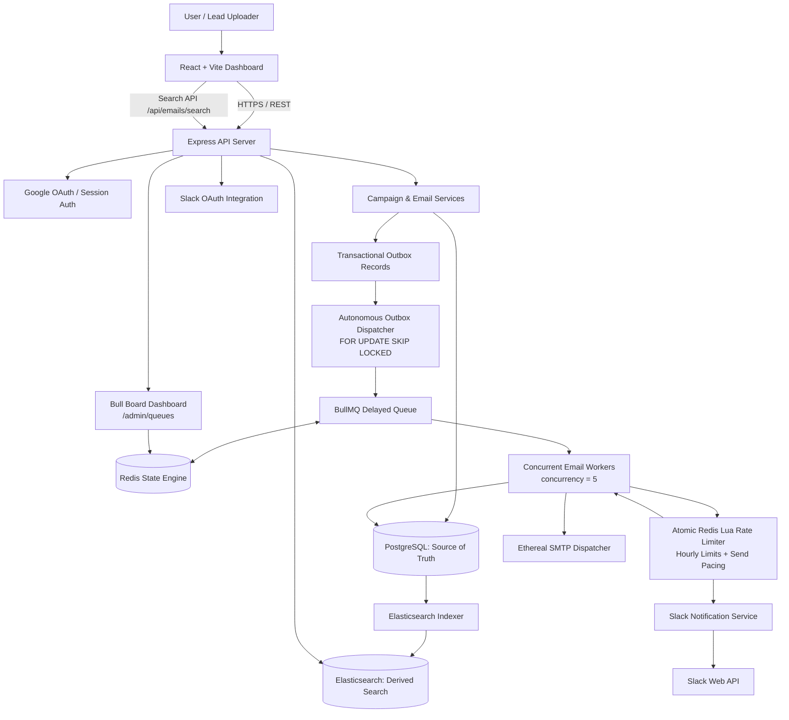

# ReachInbox Full-Stack Email Scheduler

A production-minded distributed email scheduling application built with **TypeScript**, **Express**, **PostgreSQL**, **Redis**, **BullMQ**, **Ethereal SMTP**, **Elasticsearch**, **Slack OAuth**, **Google OAuth**, and **React**.

---

## 1. High-Level System Architecture



### Core Thesis
> **PostgreSQL is the source of truth, Redis/BullMQ is the execution engine, and Elasticsearch is a derived search index.**

---

## 2. Technical Mechanics & Design Decisions

### 2.1 Scheduling Calculation
When scheduling a campaign with start time $T_{start}$, interval delay $D$ (seconds), and $N$ recipients, the planned execution time for recipient $i$ ($i \in [1, N]$) is computed deterministically:

$$T_i = T_{start} + ((i - 1) \times D)$$

Every email's `scheduledAt` timestamp is calculated and persisted in PostgreSQL before any job is pushed to the queue.

### 2.2 Transactional Outbox Pattern
A common failure mode in distributed queue architectures is the **dual-write problem**: committing to the database succeeds, but pushing to the queue fails (process crash or network blip), permanently losing scheduled jobs.

ReachInbox solves this with the **Transactional Outbox Pattern**:
1. When a campaign is submitted, PostgreSQL executes a single atomic transaction inserting:
   - 1 `Campaign` record
   - $N$ `Email` records
   - $N$ `Outbox` records
2. An autonomous background dispatcher process polls `outbox_records` using:
   ```sql
   SELECT id, payload, attempts, "availableAt"
   FROM outbox_records
   WHERE status = 'pending' AND "availableAt" <= NOW()
   ORDER BY "availableAt" ASC
   LIMIT 50
   FOR UPDATE SKIP LOCKED;
   ```
3. Records are claimed with database row locks (`SKIP LOCKED`), ensuring multiple dispatcher instances can run concurrently without race conditions or deadlocks.
4. Jobs are published to BullMQ with deterministic IDs (`email-${emailId}`).
5. Only upon queue confirmation is the outbox record marked `published`.

### 2.3 Distributed Atomic Hourly Rate Limiting
To enforce sender limits across multiple worker instances and server nodes, ReachInbox executes an atomic **Redis Lua script**:
- Key pattern: `rate-limit:sender:{senderId}:{hourWindow}`
- Pacing key: `pacing:sender:{senderId}`
- If hourly capacity is exhausted:
  - The email is **never dropped or permanently failed**.
  - The job is marked `deferred` in PostgreSQL.
  - BullMQ reschedules the job targeting the opening of the next hour window.
  - The worker slot is released immediately (no blocking `setTimeout` or thread sleeping).
- If minimum send pacing interval (`minDelayMs = 2000`) has not elapsed:
  - The job is deferred for the remaining delta, ensuring smooth spacing.

### 2.4 Slack OAuth & Alert Deduplication
When a sender reaches their hourly capacity limit:
1. `SlackNotificationService` formats a Block Kit notification detailing the sender, hourly limit, number of deferred emails, and next available window.
2. An atomic Redis deduplication key `slack:alert-sent:{senderId}:{windowKey}` with a 1-hour TTL prevents spamming the channel with dozens of deferred alerts in the same hour window.
3. If Slack is not connected or credentials are missing, email delivery continues unhindered (non-blocking fallback).

### 2.5 Restart Recovery & Crash Resilience
- Redis is configured with `appendonly yes` and `maxmemory-policy noeviction` so delayed jobs and queue state survive container and server restarts.
- BullMQ automatically resumes pending and delayed jobs upon reconnection.
- If a crash occurs before outbox records are published, the outbox dispatcher publishes them on restart.
- Workers atomically transition state:
  ```sql
  UPDATE emails
  SET status = 'processing', attempts = attempts + 1, "updatedAt" = NOW()
  WHERE id = :id AND status IN ('scheduled', 'deferred')
  RETURNING *;
  ```
  If an email was already marked `sent` or `cancelled`, the worker safely aborts, guaranteeing that confirmed sends are never re-sent.

### 2.6 The Exactly-Once Delivery Boundary
SMTP does not provide a two-phase commit protocol. If the SMTP server accepts an email but the worker process dies before persisting `status = 'sent'` in PostgreSQL, a retry could theoretically send a duplicate message.
ReachInbox mitigates this by:
- Using atomic conditional claims (`scheduled` $\rightarrow$ `processing`).
- Storing Ethereal's `providerMessageId` upon successful response.
- Classifying errors so non-retryable failures do not trigger duplicate dispatches.

---

## 3. Technology Stack

| Layer | Technology | Role |
| :--- | :--- | :--- |
| **Frontend** | React 18 + Vite + TypeScript | Modern, responsive dashboard & compose workflows |
| **Styling** | Tailwind CSS | Responsive styling & status indicators |
| **Backend** | Node.js + Express + TypeScript | REST APIs, validation, and domain logic |
| **Database** | PostgreSQL 16 (Docker port 5433) | Authoritative source of truth |
| **ORM** | Prisma | Schema management, type safety, and migrations |
| **Queue** | BullMQ | Delayed scheduling, worker pools, retries |
| **Cache/State** | Redis 7 (Docker port 6379) | Distributed rate limiting, pacing, BullMQ backend |
| **SMTP Testing** | Nodemailer + Ethereal SMTP | Live mock email delivery & test preview URLs |
| **Search Engine** | Elasticsearch 8.13.4 (Docker port 9200) | Full-text email search by recipient & subject |
| **Observability** | Bull Board (`/admin/queues`) | Real-time queue metrics and job visualizer |
| **Auth** | Google OAuth 2.0 & Demo Access | User identity and authorization |
| **Notifications**| Slack OAuth + Slack Web API | Real-time rate-limit channel alerts |

---

## 4. Getting Started

### 4.1 Prerequisites
- **Node.js**: v18+ (tested on v24.11.0)
- **Docker Desktop**: for running PostgreSQL, Redis, and Elasticsearch containers

### 4.2 Start Infrastructure Services
```bash
docker compose up -d
```
This starts:
- PostgreSQL on `localhost:5433`
- Redis on `localhost:6379`
- Elasticsearch on `localhost:9200`

### 4.3 Install Dependencies & Setup Database
```bash
npm install
npm run build --workspace=@reachinbox/shared
npx prisma db push --schema=apps/backend/prisma/schema.prisma
npx ts-node apps/backend/src/prisma/seed.ts
```

### 4.4 Run Development Servers
```bash
# Terminal 1: Backend API, Outbox Dispatcher, and Email Worker
npm run dev:backend

# Terminal 2: React + Vite Frontend Dashboard
npm run dev:frontend
```
- **Frontend Dashboard**: [http://localhost:5173](http://localhost:5173)
- **Backend API**: [http://localhost:5000](http://localhost:5000)
- **Bull Board Queue Monitor**: [http://localhost:5000/admin/queues](http://localhost:5000/admin/queues)

---
